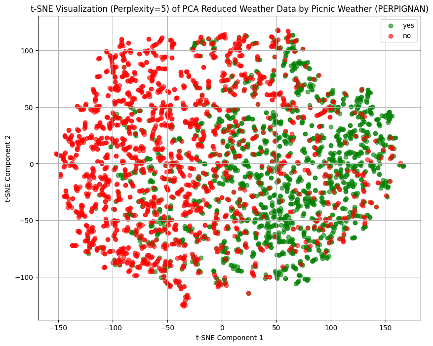
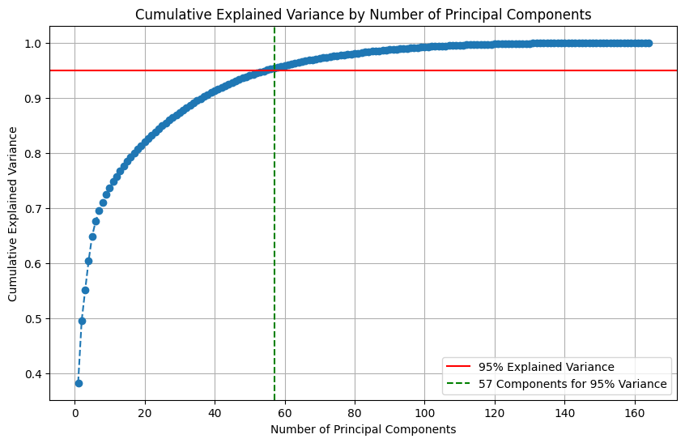
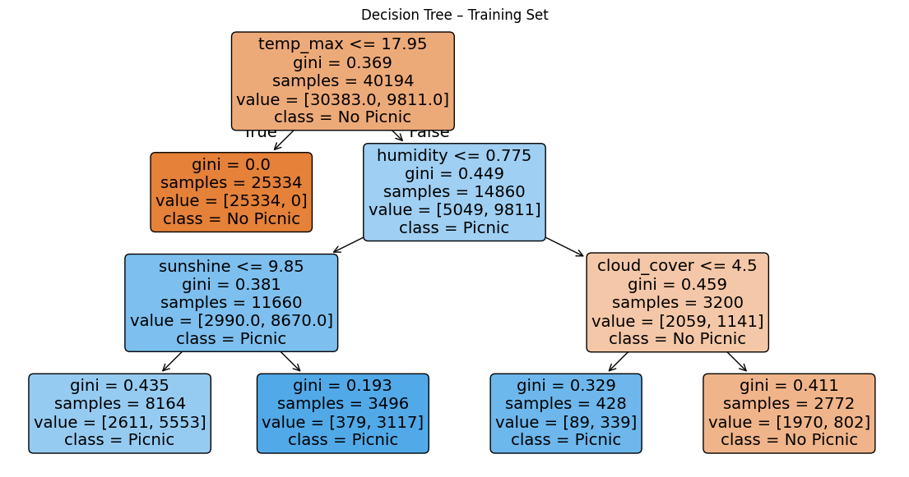
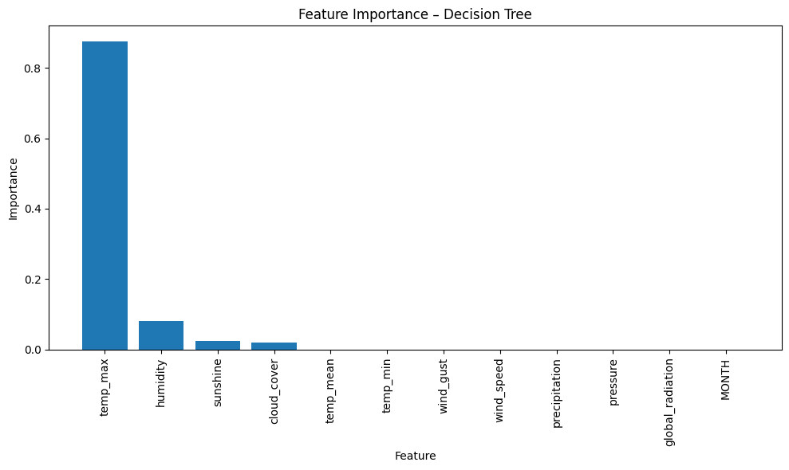
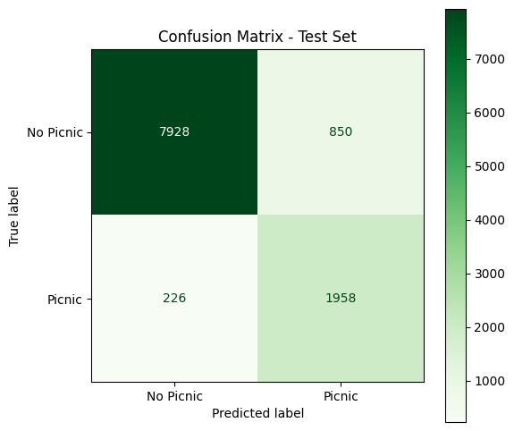

# Will it Picnic? 🧺🌦️
### Predicting picnic-friendly weather across 18 European cities with Machine Learning

University team project for the course **Algoritmi e Applicazioni per l'Intelligenza Artificiale** (July 2025).

We built an end-to-end machine learning pipeline that takes daily weather observations and predicts whether the day is suitable for a picnic. It covers data cleaning, feature selection, dimensionality reduction, and a comparison of five classification approaches, from a single decision tree to neural networks.

📓 **Notebook:** [`picnic_weather_classification.ipynb`](picnic_weather_classification.ipynb) · if GitHub does not render it (it is large because of the plots), open it on [nbviewer](https://nbviewer.org/github/<LiberaCmb>/picnic-weather-ml/blob/main/picnic_weather_classification.ipynb)
📄 **Full report (73 pages):** [`docs/report.pdf`](docs/report.pdf)

<p align="center">
  
</p>

---

## The data

The [Weather Prediction Dataset](https://doi.org/10.5281/zenodo.7053722) (Huber et al.) contains daily observations from **18 European weather stations** between **2000 and 2010**: **3,654 days** and **165 features**, including temperature (mean/min/max), cloud cover, humidity, pressure, global radiation, precipitation, sunshine and wind. The original measurements come from [ECA&D](https://www.ecad.eu).

The target is a boolean label per city, `<CITY>_picnic_weather`, saying whether that day was suitable for a picnic.

## Pipeline

**1. Exploratory analysis**
Class balance per city. For example, Sonnblick, an observatory above 3,000 m, never has picnic weather, while Perpignan is fairly balanced.

**2. Data cleaning**
- Mapped missing values
- Detected sensor errors with box plots, such as negative cloud cover and pressure values close to zero in Stockholm and Tours, and replaced them with the mode or the mean
- Standardized features where the model needs it (k-NN, neural networks)

**3. Feature selection**
- Pearson correlation matrix across all features
- For pairs with |r| > 0.8, kept the variable that is more correlated with the target

**4. Dimensionality reduction**
- **PCA**: 57 components retain 95% of the variance
- **t-SNE** on the PCA-reduced data to see how picnic and non-picnic days separate

<p align="center">
  
</p>

**5. Classification**
The data was reshaped to one row per city per day and split **70 / 15 / 15** (train / validation / test) **by city**, so the test set contains stations the models have never seen.

| Model | Key settings |
|---|---|
| Decision Tree | `max_depth=3`, Gini impurity |
| Random Forest | ensemble of decision trees |
| XGBoost | gradient-boosted trees |
| k-NN | `k=9`, standardized features |
| Neural Network | TensorFlow/Keras, dense layers + dropout, **ReLU vs tanh** |

Hyperparameters were chosen with validation curves, and generalization was checked with learning curves.

## Results (test set)

| Model | Accuracy | AUROC | Training time (s) | Interpretability |
|---|---|---|---|---|
| Decision Tree | 0.90 | 0.961 | 0.025 | High |
| Random Forest | 1.00 | 1.000 | 1.632 | Medium |
| XGBoost | 1.00 | 1.000 | 0.377 | Medium |
| k-NN (k=9) | 0.92 | 0.970 | 0.082 | Low |
| Neural Network (ReLU) | 0.99 | 0.999 | 846.4 | Low |
| Neural Network (tanh) | 0.99 | 1.000 | 217.1 | Low |

<p align="center">
  
</p>

<p align="center">
  
  
</p>

**Main findings**
- **Maximum temperature** is by far the most important feature, followed by humidity, sunshine and cloud cover. A depth-3 tree that uses these four variables already reaches about 90% accuracy and is fully readable.
- **Tree-based ensembles** (Random Forest, XGBoost) offer the best balance between performance, training time and interpretability through feature importance.
- With the **tanh** activation, the network trained about 4× faster than with ReLU and scored a slightly higher AUROC.

## Notes and limitations
- The picnic labels appear to be built from weather variables in the same dataset, such as temperature, sunshine and humidity thresholds. The near-perfect scores of the ensembles and neural networks therefore mean that the models recovered the labelling rule, not that the task is solved for real-world forecasting. The interpretable decision tree makes this visible.
- The labels are imbalanced (more "no picnic" days), so we report AUROC, precision, recall and F1 alongside accuracy.
- The models classify a day from that day's observations. They do not forecast future days.

## Repository structure

```
├── picnic_weather_classification.ipynb   # full analysis, with outputs
├── data/
│   ├── weather_prediction_dataset.csv
│   ├── weather_prediction_picnic_labels.csv
│   └── metadata.txt                      # feature descriptions and units
├── docs/
│   └── report.pdf                        # project report
├── images/                               # figures used in this README
└── requirements.txt
```

## How to run

```bash
git clone https://github.com/<LiberaCmb>/picnic-weather-ml.git
cd picnic-weather-ml
pip install -r requirements.txt
jupyter notebook picnic_weather_classification.ipynb
```

The notebook was developed in Google Colab. Run the cells in order, because some intermediate CSVs (selected features, PCA-reduced data) are generated along the way and saved in `data/`.

## Tech stack
Python · pandas · NumPy · scikit-learn · XGBoost · TensorFlow/Keras · Matplotlib · Seaborn · Jupyter / Google Colab

## Authors
- Alessandra Balestrieri
- Antonio Carboncino
- Libera Pasqualina Ciambriello

## Data credits
Huber, F., van Kuppevelt, D., Steinbach, P., Sauze, C., Liu, Y., Weel, B. *Will the sun shine? – An accessible dataset for teaching machine learning and deep learning.* Dataset: [doi.org/10.5281/zenodo.7053722](https://doi.org/10.5281/zenodo.7053722)

Klein Tank, A.M.G. and Coauthors, 2002. *Daily dataset of 20th-century surface air temperature and precipitation series for the European Climate Assessment.* Int. J. of Climatol., 22, 1441-1453. Data and metadata available at [ecad.eu](https://www.ecad.eu)
